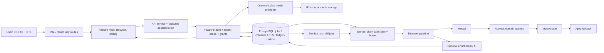

# Helix Intelligence — مراجعة المنتج والتقنية

**التاريخ:** 20 أكتوبر 2026. **الحالة:** audit draft، مش موافقة على إطلاق أو merge.

## النطاق وحدود الدليل

- كود التطبيق المتراجع: `fix/intelligence-W4` عند `eab70cc75bbc2aa8fe841a2c792f72bfd8e7e957`. مرجع المقارنة المحلي: `main` عند `5b458061c04ee772a49b123568fd008c14e9d646`. عبارة «production بيعمل كذا» جاية من وصف صاحب المشروع، مش زيارة أو فحص للـproduction.
- فرع المراجعة: `audit/helix-full`، من W4. **كل الملفات المنشورة هنا تحت `docs/audit/` فقط**. مافيش app-code fixes أو merge أو force-push أو manual deployment أو وصول لحسابات/DB إنتاج. شغل إصلاح checks السابق اتوقف لما طلب المراجعة وصل، والتعديلات غير المنشورة اتحفظت في stash محلي خارج الـaudit diff.
- اتقرت `README.md`، `ARCHITECTURE.md`، `DEVELOPMENT.md`، `API_CONTRACTS.md`. `DESIGN_SYSTEM.md` مش موجود في الـsnapshot: **not verified**.
- Managed Vite Preview + FastAPI محلي + PostgreSQL 16.15 جديد `helix_audit_w4`، migrations عند head، `USE_MOCKS=false`. الـAPI شغال بدور `NOSUPERUSER NOBYPASSRLS`، ومستخدم migration منفصل. اتعمل حسابين اختبار محليين بس للدخول وadmin/pending access؛ **ما اتزرعش أي creative أو lead أو score أو testimonial أو AI output**.
- مفاتيح المزوّدين مش موجودة في بيئة الـAPI المعزولة، وطلبات HTTPS الخارجية في الـbrowser اتمنعت. بالتالي provider-backed search/generation/email وكل نتائجها **not verified**؛ مفيش mocks اتحطت في الواجهة بدلها.
- `real` في الجرد معناها الكود/API أو المحتوى موجود؛ مش شهادة بنجاح vendor integration. `partial` معناها جزء من outcome غير متحقق. `empty` حالة محلية حقيقية من غير records. `broken` مستخدمة بس لفشل مرصود. «unused» في API inventory معناها **مش متطابق مع frontend literals**، مش تصريح بحذفه.

## Helix إيه، ولمين؟

Helix المفروض يبقى workstation لفرق growth والوكالات اللي بتراجع إعلانات المنافسين باستمرار.
بدل فتح مكتبات إعلانات وملاحظات متفرقة، المستخدم يبحث ويحفظ إعلان بمصدره وتاريخ جلبه.
Discover هو نقطة الدخول: query → استخراج → creatives قابلة للمراجعة، مش وعد بأرقام ROAS أو conversion غير متاحة.
Intelligence يحاول يلخّص الأنماط اللي في الـcorpus، وCreate يستخدمها في creative brief أو توليد اختياري.
Performance وMonitors المفروض يضيفوا متابعة زمنية وتغيّرات؛ ده مش بديل لبيانات أداء first-party فعلية.
القيمة الأقرب للشحن دلوقتي هي **بحث منافسين موثوق وقابل للتتبّع**، مش بيع أربع منتجات AI كاملة مرة واحدة.
الوصول قرار admin يدوي، مش checkout ولا trial ينتهي فيتحول تلقائيًا لخطة مدفوعة.

### English pitch

Helix Intelligence is an AI-assisted competitive advertising research workspace for growth teams and agencies. It brings source-linked ad discovery, a reviewable creative library, recurring-pattern analysis, and optional creative briefing into one workflow. Its core promise is to reduce the manual work of reviewing competitors’ public ads while keeping provenance, freshness, and unknown data explicit. Access is administrator-approved; provider availability and workspace permissions determine which capabilities are available. Performance estimates and AI interpretations are not presented as verified conversion outcomes.

### شكل النظام end-to-end

الأسهم بين مصادر Discover هنا ترتيب fallback مرصود في الكود، مش إن كل query بيستخدم كل مصدر. README/Architecture عندهم أوصاف لسلاسل مختلفة؛ المرجع التنفيذي والتفصيل في [Discover trace](DISCOVER-TRACE.md). وجود outbox في W4 تحسن عن main، لكن مش ضمان تشغيل worker أو سلامة lease تحت كل مدة تنفيذ.

## أهم 10 نتائج

| # | الأولوية | النتيجة المرصودة / درجة اليقين | الأثر والخطوة المقترحة |
|---|---|---|---|
| 1 | P0 | `Resolving sources` ممكن يبقى **label ثابت مضلل**: `JobProgress` يقرأ stage index، بينما backend يحدّث `stage_label`. السلسلة ممكن تكون لسه شغالة. [trace](DISCOVER-TRACE.md)، `src/features/discover/JobProgress.jsx` و`backend/app/services/discover_service.py`. سبب job الإنتاج نفسه **not verified**. | اعرض progress/last heartbeat من السيرفر واربط job/provider timings؛ ما تعلنش root cause إنتاج من النص الظاهر بس. |
| 2 | P0 | مهلة الواجهة 240s وCancel بيوقفوا المتابعة المحلية، مش تنفيذ Discover على السيرفر؛ مفيش Discover cancel endpoint. `src/hooks/useDiscoverySearch.js:8,171-182`، `src/services/config.js:38`، [trace](DISCOVER-TRACE.md). | server deadline + cancellation متحقق من tenant، ورسالة صريحة لو العملية لسه شغالة؛ اختبر terminal state/refund. |
| 3 | P0 | حدود انتظار Metapi قد تتجاوز 120s lease بفرق كبير، ومسار التجديد مش ظاهر في التنفيذ المفحوص. ده **risk مثبت من الحدود**، مش إثبات إن duplicate claim حصل فعليًا. [trace](DISCOVER-TRACE.md). | heartbeat/lease renewal وربط المدة بالـdeadline؛ اختبار worker crash/reclaim/concurrency قبل scale. |
| 4 | P1 | قرار admin-granted access مش متسق مع الواجهة: حساب pending جديد عرض `Trial Ended — Select a Plan to Generate`، وصفحة billing/admin plans فيها Trial/Subscription language. [Create EN](screens/create-tab-pending-access-en.png)، [Billing](screens/billing-en.png)، `src/pages/CreatePage.jsx`، `BillingPage.jsx`. | خَلّي Access & Usage مصدر الحقيقة، شيل purchase/trial promises من العرض، واحتفظ بالـledger/grants لضمان العزل وidempotency. |
| 5 | P1 | `lang=ar` و`dir=rtl` شغالين، بس login/docs/Create/admin/chrome لسه فيهم English كتير. ده **RTL جزئي، مش localization كاملة**. [route matrix](BROWSER-INVENTORY.md) و[screens](screens/README.md). | glossary وEN/AR strings لكل surface، mixed-script dates/numbers، keyboard/focus tests وvisual review؛ ما تعتبرش قلب الاتجاه ترجمة. |
| 6 | P1 | LegalPage بتقول draft/unapproved؛ الـlegacy footer لسه بيقول إن كل auth/provider data encrypted وTLS 1.3 وغيرها. ده تعارض مع session token في JS-readable `localStorage`، وend-to-end deletion مش مثبت. `src/features/marketing/MarketingFooter.jsx:29-55`، `src/services/sessionStore.js`، [legal](screens/legal-en.png). | توحيد legal copy، privacy contact متحقق من المشغّل، retention/deletion runbook مجرّب وموافقة Ziad/counsel، من غير ادعاء compliance. |
| 7 | P1 | الـgates مش green: typecheck **483**، lint **159**، pyflakes **127** diagnostics؛ full backend tests **224 passed / 2 failed**. build وfrontend tests ناجحين. [evidence](evidence/COMMANDS.md). migration fresh/drift نجحوا لكن legacy proof مربوط بـold head. | إصلاح حقيقي للـdiagnostics وتحديث tests للـsanitized errors/head الحقيقي؛ ممنوع exclusions أو تسريب provider errors عشان test يعدّي. |
| 8 | P1 | Scope ووعود الملاحة أكبر من core المتحقق: ستة أقسام `live` في `src/app/navigation.js`، بينما README بيقول Discover بس end-to-end. Guide/docs/Create descriptions مش متطابقة. [frontend](FRONTEND-INVENTORY.md). | خفّي التجريبي خلف flags، عرّف «real data vs inferred»، وادمج guide/docs المتكررين؛ مش مطلوب حذف feature data. |
| 9 | P2 | direct load لـ`/api-keys` محليًا رجّع JSON 404؛ SPA sidebar navigation فتح الصفحة. `vite.config.js` proxy `'/api'` بيطابق `'/api-keys'` كمان. [direct](screens/api-keys-en.png)، [SPA](screens/api-keys-tab-spa-navigation-en.png). | ضيّق proxy match لـ`/api/`، واختبر direct links وrefresh. **ده دليل local dev فقط**؛ Vercel production behavior مش متحقق. |
| 10 | P2 | وزن main JS **481,532 bytes raw / 147,494 gzip**، CSS **135,665 / 25,694**، مع polling متكرر. UI status زي `ALL SYSTEMS NOMINAL`/default provider operational مش قياس خدمة حقيقية. [build](evidence/build.log)، [performance](PERFORMANCE-STRATEGY.md)، `src/pages/admin/DataSourcesPage.jsx`. | performance budgets وvisibility-aware polling وprovider telemetry حقيقي؛ unknown يفضل unknown، مش success. |

## جرد كل صفحة وتاب

الجرد الكامل: [Frontend inventory بالكود والمكونات والـendpoints](FRONTEND-INVENTORY.md)، [كل المسارات الفعلية ولقطات EN/AR](BROWSER-INVENTORY.md)، و[كل screenshots](screens/README.md).

- اتفتحت **68 concrete paths** باللغتين، بما فيها كل **18 docs articles**، aliases والـredirects، وصفحات admin/customer. عدد route declarations/template paths في source هو **49**؛ الأرقام مختلفة لأن dynamic docs اتوسعت لصفحات فعلية.
- الصفحة اللي محتاجة token/record غير موجود اتصورت كـinvalid/empty/access state، مش ببيانات مصطنعة. ده يشمل `/team/accept` من غير invite token و`/playbook/audit-not-found` من غير share record.
- اتراجعت تبديلات Image/Video وكل modes المرصودة في Create، Scout workspace/org jobs، notification filters، Guide steps، Updates editor/card preview من غير حفظ/نشر، وadmin support filters. الـcapture manifest بيسجل النقرات والـactual route؛ المحاولات اللي selector فيها ما اتطابقش موجودة raw لكن **مش محسوبة كتحقق**.
- تبويبات lead/creative detail اللي محتاجة نتائج حقيقية، successful generation، support-ticket thread بعد إرسال، populated monitor diffs وreal invitation acceptance: **not verified**. مفيش provider key عشان أستبدل غيابها بـmocks.
- Initial loading states محفوظة كدليل أول تحميل. `tab-settled` لقطات منفصلة بعد bounded network-idle انتظار؛ `ok: true` في manifest معناه screenshot اتعمل، مش إن feature شغال بالكامل.
- `/guide` و`/admin/guide` و`/docs` و`/playbook/:publicId` محتاجين تسميات أوضح. Messages & Updates بيروح notifications مش product منفصل. `AdminPendingPage` orphan component، مش دليل إن كل admin routes placeholders.

## API والمزوّدين

[API inventory الكامل method + path + frontend references](evidence/api-inventory.md) ومعاه [machine-readable inventory](evidence/api-inventory.json).

- Static scan: **168 route records**؛ **166 mounted records** يمثلوا **165 unique method/path** بسبب تكرار `GET /api/health`؛ **2 declarations unmounted** في analysis router. Swagger المحلي اتراجع بـ`GET /api/openapi.json`: [165 method/path](evidence/runtime-routes.json) مطابقين للـstatic mounted set، من غير استدعاء protected/provider endpoints.
- الـfrontend scan رصد **130 request references**، ومفيش literal target بلا backend match في النطاق المفحوص. ده مش contract/authorization proof، والـdynamic أو external clients ممكن يفوتوا على literal matching.
- قرابة **30 mounted records** من غير frontend match ثابت: اعتبرهم unused-by-browser candidates بس؛ cron/webhooks/CLI/worker مش لازم يبقوا frontend consumers. Scout كمان mounted على `/api/scout` و`/api/v1/scout`؛ duplication محتاج versioning قرار مش حذف عشوائي.
- تصنيف كل provider، موضعه، env names، هل wired/optional/dead-looking، وهل له cost محتمل: [Backend provider inventory](BACKEND-AUDIT.md). الأسعار والعقود والـquotas الفعلية **not verified**؛ مفيش أسعار مخترعة.
- المصدر فيه Meta Graph/Ad Library، Metapi، Adyntel، Apify، ScrapeGraph، Bright Data paths، Scrapling، LLM/media adapters، Resend وR2. مش كل adapter متوصل بنفس pipeline أو active deployment؛ فرق مهم بين `imported/configured`, `invoked`, و`successful`.
- API key وBYOK lifecycle لازم يفضلوا permissioned، ومفيش عرض keys أو توليد tokens اتعمل عشان screenshot.

## Discover: تفسير التعليق من غير تخمين

التحليل التفصيلي والمقارنة بـmain موجودين في [DISCOVER-TRACE.md](DISCOVER-TRACE.md). على main، job dispatch كان مربوط بـin-process `BackgroundTasks`/`asyncio.create_task`؛ W4 ضاف outbox/recovery. دي نقلة مهمة، لكن label/index وserver execution budget وworker lease لسه مش contract متوافق واحد.

في الـpreview المعزول فيه مفيش provider keys ولا نتائج بحث مصطنعة؛ ما اتشغّلش job vendor-backed. لذلك **ما نقدرش نثبت root cause لبلاغ production**. الاحتمالات اللي لازم تتفصل بقياس: provider timeout/rate limit، worker مش claiming/lease منتهي، transaction/finalization، أو UI متابع stage قديم. مش هنقول إن Neon أو Render أو provider بعينه هو السبب من غير job-correlated timestamps.

المسموح إثباته هنا: الـcode path، حدود الوقت، سلوك hook tests، وحالة access pending المحلية. إعادة إنتاج hang حقيقي محتاجة بيئة staging مصرح بيها ومصدر واحد بمفاتيح مشغّل متاحة، job ID وتوقيتات sanitised، من غير بيانات إنتاج.

## Frontend / Backend / Database بالبساطة

- **Frontend:** routes lazy، Page → hook → service، transport موحّد نسبيًا. ده أساس كويس. الديون: props/type drift، forms كتير بتستدعي services مباشرة، لغة/chrome متفرقة، ومحتوى تسويقي/docs أقدم من التنفيذ. بدل rewrite: ثبّت contracts واختبارات الرحلة الأساسية قبل التقسيم.
- **Backend:** FastAPI routers → services → async SQLAlchemy. فيه tenant context وRLS، grants وledger، jobs/outbox وworker reconciliation. التدفقات الكبيرة في discover/admin/scout فيها مسؤوليات كتير؛ افصل orchestration عن provider adapters بعد regression coverage، مش قبلها.
- **Database:** [جرد 41 ORM mappings والغرض والمخاطر](evidence/schema-inventory.md). مجموعات أساسية: `users/organizations/organization_members` للهوية؛ access requests/grants للصلاحيات؛ scrape jobs/creatives/scores/patterns/insights/cache للبحث؛ monitors/runs/events للمتابعة؛ work items/heartbeats للـjobs؛ credit ledger/reservations/idempotency للاستهلاك؛ media/lead/scout tables للـoptional loops؛ support/notifications/updates/audit للتشغيل.
- الـschema inventory استدلال من mappings، مش إعلان إن كل table مستخدم في production. Fresh DB عند head مرّ، لكن ده ما يثبتش إن DB قديمة stamped ahead من schema أو ملوثة هتعدّي بأمان من غير migration proofs/backup.

## حكم الـBackend

التفاصيل والمصادر والإصلاح لكل بند في [BACKEND-AUDIT.md](BACKEND-AUDIT.md). الحكم المختصر بعد دمج اختبارات الـparent:

| المحور | الحكم | الدليل / الإصلاح العملي |
|---|---|---|
| Structure | acceptable | routers/services/models موجودين؛ orchestration كبير ومتشابك. قسّم بعد tests، من غير framework rewrite. |
| API design/consistency | acceptable | OpenAPI inventory كامل؛ aliases وduplicate health وAPI docs قديمة. contract tests وversion/deprecation policy. |
| Error handling | acceptable | sanitization وstable codes اتحسنوا؛ stale test بيطلب provider text. وحّد envelopes وميّز no-result/outage. |
| Auth/tenant isolation | acceptable | deny-by-default RLS، restricted-role startup guard، grants واختبارات؛ production config **not verified**، وJS-readable localStorage باقي risk. |
| DB/migrations | acceptable مع risk عالي | fresh upgrade/check نجحوا؛ compatibility/forward repairs وold-head test fragility. backup + dirty upgrade/rollback/restore proof. |
| Tests/CI | bad كحالة gate حالية | frontend tests/build ناجحين، بس type/lint/pyflakes/full backend فاشلين. أصلح failures، مش testscope/coverage. |
| Observability | bad بالنسبة للتشغيل الواسع | structured events موجودة، بس provider/job latency/lease وtransport/alert delivery مش متحققة. correlation + SLO + actionable alerts. |
| Security | acceptable على الكود، مش certification | SSRF/role/grant/secret-scan safeguards؛ threat model وdependency review وdeletion/contact approval لازمين. |
| Performance | not verified؛ acceptable design جزئيًا | W3 SQL bounds/caches أفضل، بس local empty DB مش throughput proof. قس query plans/provider budget ومتعرضش synthetic success. |
| Scalability | bad كضمان جاهزية حالي | durable work records مش كفاية من غير lease/capacity/backpressure proof وworker operations. اختبر reclaim، limits وqueue age قبل distribution. |

## الوزن والأداء

[الأرقام وطريقة القياس](PERFORMANCE-STRATEGY.md)، [build log](evidence/build.log)، [dependency inventory](evidence/dependencies.md).

- `pnpm build`: **1,982 modules**، **14.99s** محلي؛ emitted files إجمالي **1,958,073 bytes**. main JS **481,532 / 147,494 gzip**؛ DocSearchModal **182,288 / 51,820 gzip**. Raw vs gzip منفصلين؛ named imports/tree-shaking يخلو installed size مش bundle cost.
- installed node_modules حوالي **234,236,741 bytes**، Python venv **181,398,865 bytes / 58 distributions**. ده developer footprint، مش cold-start/container footprint.
- مفيش direct runtime npm dependency ثبت إنها unused؛ `driver.js` dynamic import مش dead code. ما ننصحش بحذف SQLAlchemy/asyncpg/boto/Pillow أو active scrapers لمجرد حجمهم. candidates ومخاطر الإزالة في التقرير الملحق.
- `loadMs` في capture log بيشمل browser CLI/انتظار route ومش FCP/LCP. `navigation.responseMs/domMs/loadMs` قياسات Performance API محلية لما اتسجلت. [ملخص timings](BROWSER-INVENTORY.md) بيفصلهم؛ مفيش production أو real-load benchmark هنا.
- polling متكرر في notifications/admin/scout وkeepalive ممكن يضاعف الترافيك مع كل tab/user؛ بعض الـStrictMode requests مكررة في development. لازم visibility/backoff/cache/coalescing وقياس network قبل وصف كل تكرار بأنه production bug.

## إيه يتشال أو يتخبّى؟

**دي توصيات، مفيش حذف اتعمل.** القائمة الأوسع مع impact/removal risk في [PERFORMANCE-STRATEGY.md](PERFORMANCE-STRATEGY.md) و[BACKEND-AUDIT.md](BACKEND-AUDIT.md).

| الترتيب | العنصر | القرار والرationale | مخاطر الإزالة والطريقة الآمنة |
|---|---|---|---|
| 1 | Trial/upgrade/checkout promises واسم Billing & Meter | merge في Access & Usage؛ admin grant هو model الحقيقي | ما تحذفش ledger/quota tables؛ بدّل copy/routes بredirect واختبر grant lifecycle. |
| 2 | legal policies المتكررة في footer | merge مع disclosure واحد unapproved لحد موافقة صاحبه | حافظ على stable URLs، راجع counsel/privacy contact، وإياك تعلن approval تلقائي. |
| 3 | Intelligence/Performance كـstandalone «live» promises | hide-until-built/verified؛ خَلّي insights جزء من corpus review | حافظ على source data وdeep links، feature flag وتدرّج deprecation. |
| 4 | Scout/maps/leadgen افتراضيًا لكل مستخدم | hide behind admin flags؛ مش نفس core value proposition | jobs/exports/vendor contracts ممكن تبقى موجودة؛ freeze new dispatch ثم export/usage window قبل حذف API/tables. |
| 5 | Create/media ضمن core pitch | optional integration، مش شرط لتشغيل Discover | asset retention وprovider credentials، jobs وwebhook contracts؛ ما تحذفش ملفات المستخدم. |
| 6 | guides المتكررة وScout CLI docs orphan-looking | merge navigation/docs، verify actual consumers | redirect الروابط العامة، راجع package/distribution قبل وصف CLI بأنه dead. |
| 7 | unused-by-frontend endpoints و`/api/v1/scout` alias | review/deprecate مش delete فوري | cron/webhook/CLI قد يحتاجهم؛ اطلب telemetry وversion policy. |
| 8 | runtime deps/providers/env vars | **keep لحين إثبات عدم الاستخدام**؛ لا cut لمجرد وجود import unused | AST/import/runtime وdeployment inventory، feature-owner signoff، remove config ثم code/deps تدريجيًا. |
| 9 | optional-feature tables | archive/deprecate بعد وقف الكتابة فقط | FK/RLS/retention وbackup/export وrestore rehearsal؛ لا إسقاط identity/access/ledger/outbox tables. |

## الاستراتيجية — رأي مش fact

**Open source:** ممكن يبني ثقة ويسهل self-hosting ومراجعة tenant/AI safety، بس vendor accounts والتكاليف والـdata rights وsupport مش هتختفي. root LICENSE/COPYING ما ظهرش؛ ما نسميهوش open-source legally قبل حسم الترخيص.

**Hosted SaaS:** القيمة ممكن تبقى توفير وقت بحث منافسين للوكالات/فرق growth، بشرط coverage/freshness وcost per successful search يتقاسوا. الاتساع الحالي يرفع support/provider liability قبل إثبات retention.

**Open-core:** رأيي الاختيار الأكثر توازنًا: core بحث/حفظ/تصدير موثوق، وhosted operations/connectors/scheduling/team support اختيارية. التسعير كخيارات مستقبلية **usage/team/enterprise support من غير أسعار**، مش إضافة checkout للمنتج الحالي.

أصغر منتج worth shipping: **Discover search → source-linked results → detail → saved list/export**، مع admin-approved access ومصدر بيانات واحد واضح. Monitors يدخل بعد jobs/cost correctness، وmedia/leadgen مش شرط للـactivation.

### Roadmap / high-end distribution حسب الرافعة

التقديرات دي **estimates لفريق صغير**، مش مواعيد مضمونة؛ dependencies/legal/provider approval ممكن تغيرها.

1. **Core proof / 1–2 أسبوع:** قفل Discover وaccess model؛ job deadline/heartbeat/terminal states وrefund/idempotency، مصدر واحد، smoke flow مصرح به، وhide التجريبي. قس first-result time، successful-search rate وcost.
2. **Reliability / 3–5 أسابيع:** تشغيل durable workers/outbox بlease renewal وreclaim/dead-letter/backpressure، rate limits/quotas/provider budgets، tenant-aware cache، SLO/queue-age/error alerts وrunbooks، ومصدر unknown يفضل unknown.
3. **Hosted safety / 2–4 أسابيع:** backup + restore rehearsal لـDB/media، retention/deletion/export، R2/CDN signed access، secret rotation وadmin least privilege/MFA/audit. من غير uptime claim قبل telemetry فعلية.
4. **Product quality / 3–5 أسابيع:** onboarding مبني على admin approval وحالة provider، EN/AR وRTL كاملين، performance budgets، keyboard/screen-reader/contrast، SEO/canonical/sitemap للmarketing فقط وno-index private workspaces. privacy/terms/contact/data rights بمراجعة مسؤولة.
5. **Distribution / 2–4 أسابيع pilot ثم مستمر:** design-partner agencies وgrowth teams أولًا، content حول competitor review، referral/community بعد قياس activation/retention، docs/public API read/search/export محدود وversioning، ثم scale channels. managed service/support أولى من paid acquisition واسع قبل unit economics.

## إيه اتفحص وإيه لأ؟

[الأوامر وexit codes](evidence/COMMANDS.md)، [browser manifest الخام](evidence/browser-captures.jsonl)، [screenshots index](screens/README.md).

**اتحقق:** source مقارنة W4/main، API/static schema inventories، actual local OpenAPI matching، fresh disposable migration head/drift، restricted-role API start، frontend build/type/lint/tests، backend compile/pyflakes/full tests، local route/tab/empty/pending screens باللغتين. **Tests اللي فيها mocks من repo اتشغلت كunit/regression tests بس، مش browser data أو vendor proof.**

**not verified:** production أو real accounts/logs/DB، سبب hang الإنتاج المحدد، live providers/fees/quotas/data rights، generation/email delivery، populated detail/result tabs، real monitor execution، successful invite/reset-token lifecycle، concurrency/load/availability في deployment، legal approval/privacy contact/end-to-end deletion، كل breakpoints/mobile/accessibility criteria. Missing keys اتقالت صراحة؛ ما اتغطتش بfake results.

## Single P0 next step

**ثبّت Discover كحلقة واحدة قابلة للتشخيص والانتهاء على بيئة staging مصرح بيها بمصدر حقيقي واحد: deadline/heartbeat/lease وterminal outcome موحّد، ثم job-correlated proof للنتيجة والتكلفة والعزل.** ده gate قبل أي distribution/merge/deployment، مش تكليف بتشغيل production في المراجعة دي.
